# Finance Tracker for Android

## Version 1.22 — in development

Overall personal balance, first-date report guidance, an amount calculator, ten category icons and three new themes are under test. The latest published release remains 1.21. See [1.22 specification](docs/specs/version-1.22-proposal-ru.md) and [verification](docs/testing-1.22.md).

## Version 1.21 — released November 3, 2026

Maintenance release with updated documentation and Android versionCode 6. App features and data formats are unchanged from 1.20. The download link below points to the latest published release. See [1.21 verification](docs/testing-1.21.md).

[Download Android APK](https://github.com/NikitaTestovich/Bumajnik-Android/releases/latest) · [English guide](docs/user-guide-en.md) · [Руководство на русском](docs/user-guide-ru.md)

## Version 1.20 — released November 2, 2026

Search operations by comment, amount or date, filter expenses by category, and expand categories in personal and family reports. This release adds expense comments in CSV, separate settings pages, improved charts, full backups and GitHub update checking. The public APK uses an owner-managed release signing key.

A private income and expense tracker for Android. Record everyday transactions, understand where money goes, and estimate how long a savings goal may take. Your records stay on your device; family reporting works through CSV files you choose to exchange.

> **Status:** Active testing. Feedback and bug fixes are welcome.

## Version 1.17 theme examples

Fictional-data Reports at 280dp with Russian text at 1.6 scale (the chart can scroll horizontally):

| Financial journal | Electric graphite | Color mosaic | Night analytics |
| :---: | :---: | :---: | :---: |
| 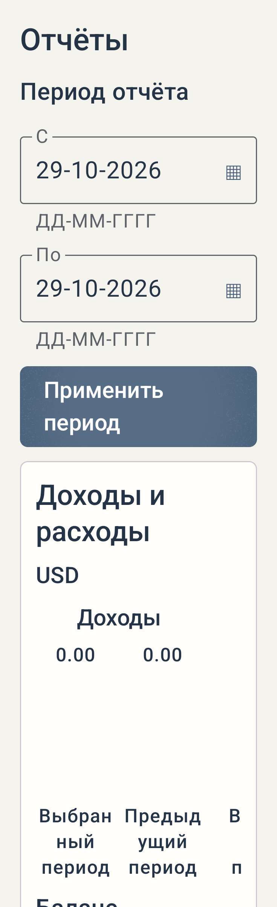 | 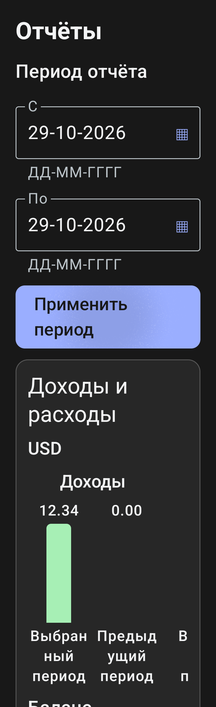 | 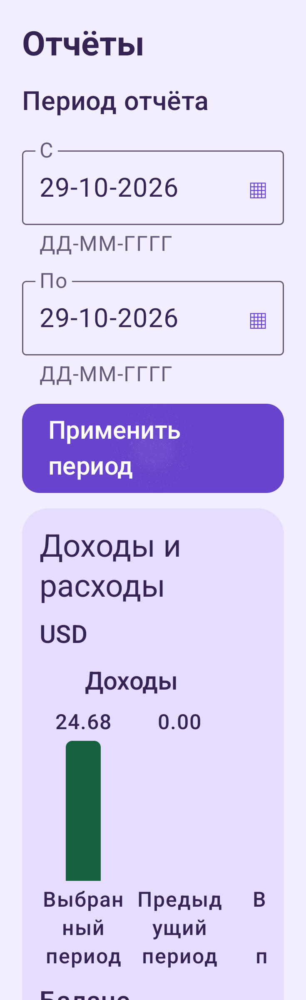 | 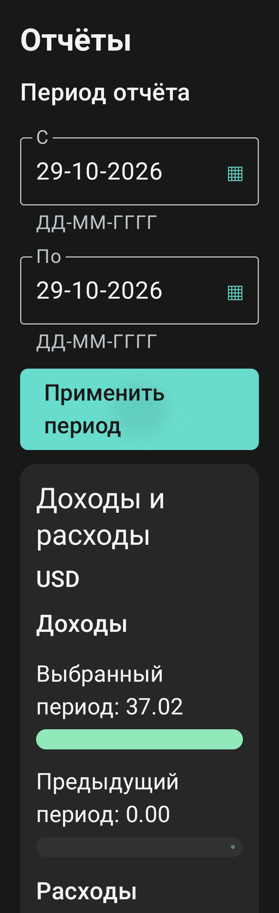 |

## Version 1.20 screenshots

These examples use fictional data.

| Operations | Personal report | Family report |
| :---: | :---: | :---: |
| 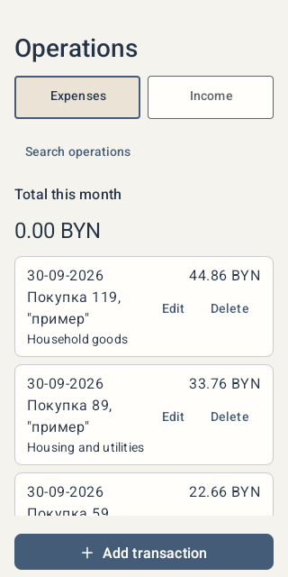 | 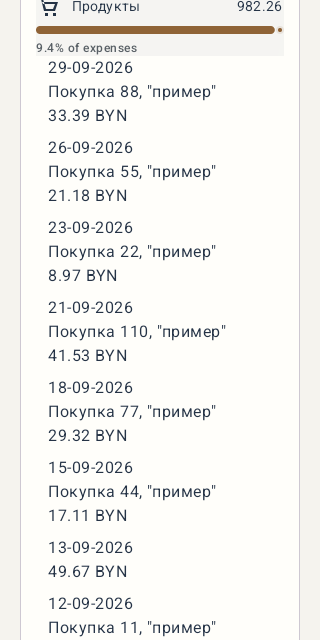 | 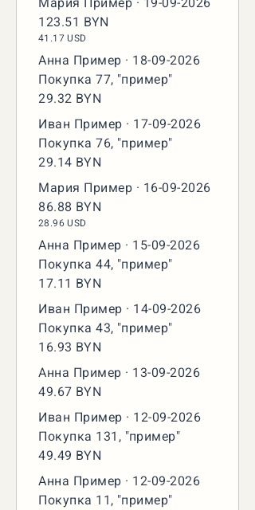 |

## Earlier screenshots

These examples were captured on an Android emulator using fictional demo profiles and contain no personal financial records.

| Home | Reports |
| :---: | :---: |
| 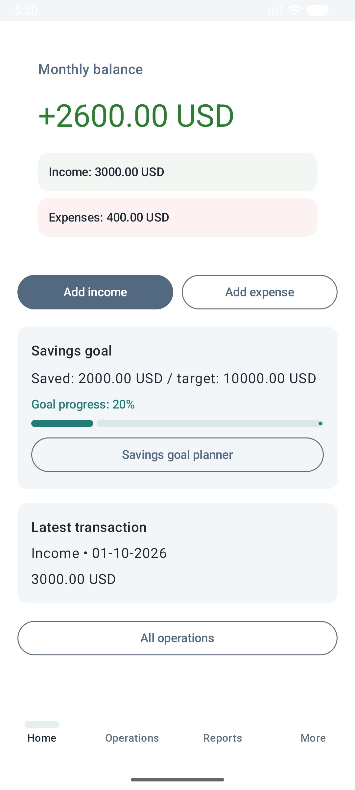 | 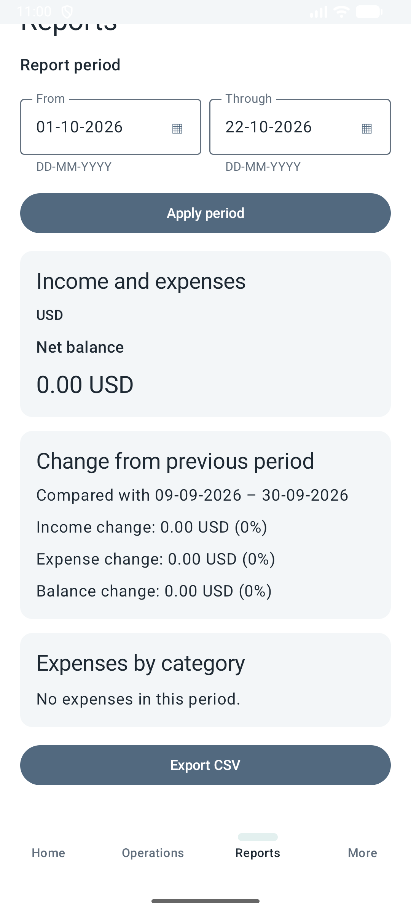 |
| **Family** | **Savings goal** |
| 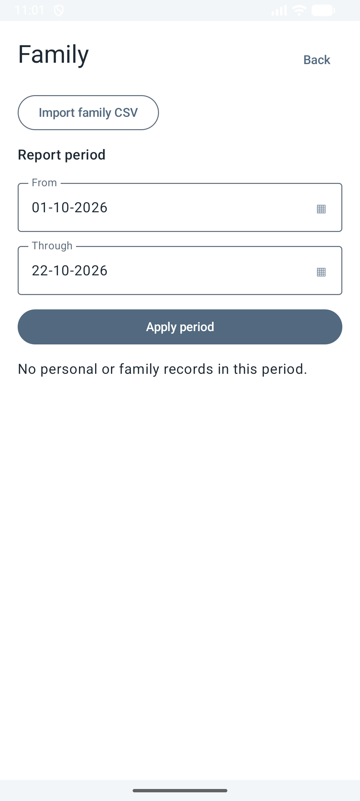 | 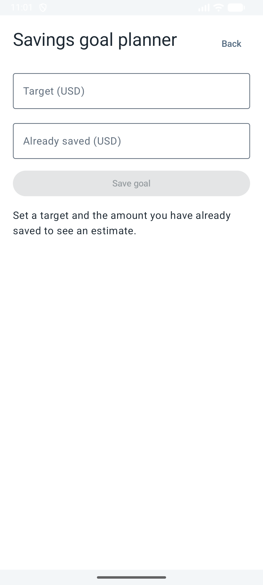 |

Version 1.15 optional monthly expense widget, captured from the emulator with fictional data: [English chart](docs/screenshots/expenses-en.png) · [Russian chart with large text](docs/screenshots/expenses-ru.png).

## What it does

- Add, edit, delete and search income and expense entries. Choose dates with a calendar or type them as `DD-MM-YYYY`. Add optional comments of up to 150 Unicode characters.
- Start with standard expense categories, create your own, rename or archive them, and choose from 30 bundled icons. Archived categories remain on older expenses; icon-only edits preserve standard translations.
- Customize Home with hide/show controls and drag or arrow ordering. The monthly expense doughnut is available in all seven themes and visible for fresh, missing and reset settings; previously saved visibility and order, including a hidden widget, remain. Hide it in Home settings or explore category amounts.
- Review monthly totals, category breakdowns, expandable expense details, and comparisons with a previous period.
- Export eight-column CSV reports/backups with income and expense comments. Import seven-column or eight-column files. Older app versions may not accept expense comments. Family reports combine categories and skip repeated records.
- Optionally protect access with a 4–10-character app code and available biometrics. When enabled, the biometric prompt opens automatically; the code appears after failure or cancellation. Recover a forgotten code through the phone screen lock without deleting records.
- Enter exchange rates manually when a report contains multiple currencies. Supported currencies: USD, EUR, RUB, and BYN.
- Plan one savings goal using your saved amount and the average surplus from up to three completed months.
- Switch between English and Russian in the profile.

## Privacy and backups

The app has no account or live synchronization. Financial records are stored locally. CSV export and import use Android's file picker; the app does not fetch exchange rates. A personal CSV backup contains transactions but not all settings or saved family imports. The separate full backup includes these items but is not encrypted and does not include app-lock credentials. Store backups securely and verify restoration before uninstalling or clearing storage; see the guide for details.

No real financial data, local SDK paths, signing keys, APKs, or backup files belong in this repository. The screenshots above show demo screens.

## Install and update

1. Open [the latest release](https://github.com/NikitaTestovich/Bumajnik-Android/releases/latest) on your phone and download the APK asset named `finance-tracker-vc<versionCode>.apk`.
2. Open the APK, allow installation from that source if Android asks, and confirm installation.
3. For future releases, open **More → Updates → Check for updates**. If a newer compatible release exists, tap **Update** and confirm in Android.

Internet is needed for checking and downloading updates, not for everyday tracking. Do not uninstall a release-signed installation to update it: compatible updates retain its data. Older debug/test builds have a different signature and require backup-and-restore migration. Personal CSV preserves personal operations, not family imports or settings; verify restoration before removing an old installation.

The public APK download, checksum and signing certificate have been verified. A live check on Android 13 correctly reports no newer update for installed 1.20. An in-app update from 1.20 to 1.21 was verified with fictional personal records. See [test evidence and remaining checks](docs/testing-1.20.md).

## Build from source

The project supports **Android 8.0 (API 26) and newer**. The generated debug APK is kept locally at `android/app/build/outputs/apk/debug/app-debug.apk`; it is not committed to Git. The local root `AppAndroidBudjets.zip` contains the signed 1.22 release APK; running `:app:archiveDebugApk` replaces that archive with a debug build.

See [build and installation instructions](android/README.md) for JDK 21, Android SDK, and Gradle wrapper setup.

To update, install a newer APK over the existing app without uninstalling it. Updates must use the same package ID and signing certificate to retain data. Local debug builds are for testing; a differently signed release requires a planned migration. See the [update guide](docs/user-guide-en.md#updating-without-losing-records).

## Guides and development

- [English user guide](docs/user-guide-en.md)
- [Руководство пользователя на русском](docs/user-guide-ru.md)
- [Development and bug reports](docs/CONTRIBUTING.md)
- [Current product specification](docs/specification.md)
- [Version 1.20 verification and remaining checks](docs/testing-1.20.md)

The project remains open for iterative testing and fixes. When reporting a bug, use sample data and remove names, amounts, and files that reveal real finances.
